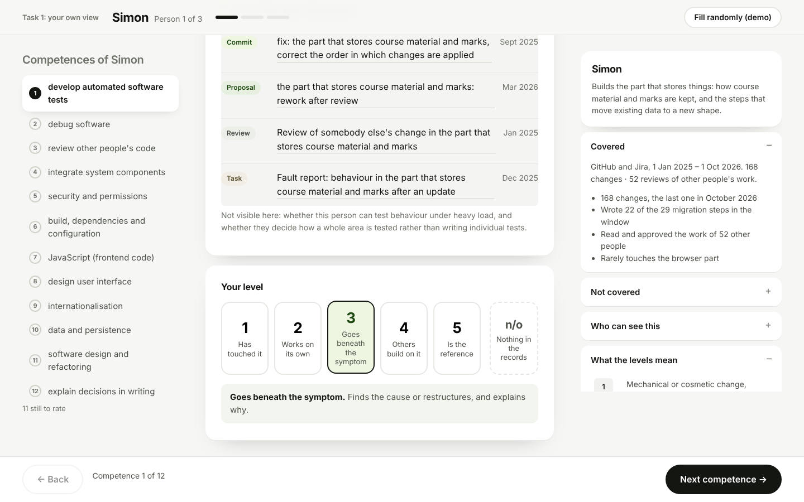
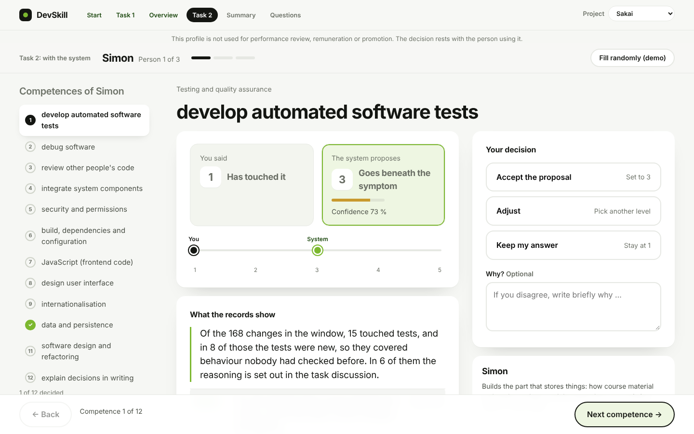

# DevSkill: requirements for the gold layer and the LLM assessment

Details of the competences, levels and coding rules are in `docs/CODEBOOK.md`. The Word version of this document is `docs/DevSkill_Requirements.docx`.

## Goal

A study tool shows a team lead three developers, one competence at a time. The tool is finished; what is missing is the part that produces this content from real data.

**Task 1:** the lead reads what the records show and rates the person alone.



**Task 2:** the same records, plus the level proposed by the system with its confidence. The lead accepts, adjusts or keeps their own answer.



## Requirements

1. **Show what the person can do (Task 1).** For every person and competence, show from the data what the person did, with concrete examples (each with date and a working link), so that a team lead can judge it alone. The text must not reveal the level.
2. **Propose a level (Task 2).** For every person and competence, a large language model (LLM) places the person on a level, based on the competences and levels defined below. The level is shown with a confidence and a reason that says why this level and not the next one up (autonomy, complexity, influence). The lead decides what to take over.
3. **Stay inside the definitions.** Only the 12 competences and the levels below are used. If the records show nothing about a competence, the result is "not observable", not a low level.
4. **Be traceable.** Every number, example and reason shown must come from the data and be checkable. The final level and the confidence must be explainable and repeatable, not an unchecked answer of the model.
5. **Show that it works.** Compare the LLM result with a reference set coded by the researcher, and report how well they agree before the result is used in the study.
6. **Model.** The researcher provides Claude Sonnet 5.5 through the Anthropic API and enters her own API key. The key stays local and is never committed to the repository (it is public).
7. **Privacy.** No names, e-mail addresses or handles reach the model or the output.
8. **Hand over to the tool.** The result is delivered as one file per project in the format below. This is the only fixed technical interface.
9. **Suggest fitting roles (optional).** From the competence results, show which occupations (ESCO occupation profiles, for example software developer or software tester) the records match best and which essential competences the records say nothing about. This is derived from the result, shows what the records demonstrate and not what the person is capable of, and is a further finding beyond the main task.
10. **Keep it separate from the study script.** For the study, some proposals will later be changed on purpose. The real result must therefore be correct and stay separate from that step.

## Competences: where they come from

Built in two directions. Top-down from ESCO (occupation *software developer*, ESCO v1.2.0). Bottom-up from a sample of about 120 evidence units (out of 3,000 for Sakai and 3,387 for NiFi) coded openly, without a list, and only then compared with ESCO. What ESCO did not cover is marked local. The list is in `model/taxonomy.json` (version 3.0).

| # | Competence | Source |
|---|---|---|
| 1 | develop automated software tests | local (e-CF B.3 Testing) |
| 2 | debug software | ESCO essential |
| 3 | review other people's code | local |
| 4 | integrate system components | ESCO optional |
| 5 | security and permissions | local |
| 6 | build, dependencies and configuration | ESCO essential and optional |
| 7 | JavaScript (frontend code) | ESCO optional |
| 8 | design user interface | ESCO optional |
| 9 | internationalisation | local |
| 10 | data and persistence | ESCO optional |
| 11 | software design and refactoring | ESCO essential and optional |
| 12 | explain decisions in writing | ESCO essential |

## Levels: where they come from

Five levels plus n/o (not observable), based on the European e-Competence Framework (EN 16234-1), which separates levels by autonomy, complexity and influence. The wording is our own, written for repository records.

| Level | Name | Meaning |
|---|---|---|
| l1 | Follows a given approach | Small, mechanical change; others set the approach |
| l2 | Completes routine tasks alone | Own approach, routine task in a known pattern, no substantial rework |
| l3 | Solves and explains the cause | Own approach, non-routine task; finds the cause or restructures, and explains why |
| l4 | Others rely on it | Builds shared pieces others rely on |
| l5 | Sets the approach for others | Others turn to the person; the approach the project follows |
| n/o | Not observable | Records show nothing about it |

**Levels describe behaviour, not the person.** Each level answers the same three questions, taken from the e-CF: who sets the approach (autonomy), how complex the task is (complexity), and who relies on the result (influence). A level is evidence for one competence in the records, never a label such as beginner or expert.

The e-CF itself defines levels only up to e-3 or e-4 for most build competences, so l4 and l5 go beyond it.

**The levels can be challenged.** Other levels may be used, but only on the basis of literature or a framework (for example e-CF, SFIA, the Dreyfus model). A change needs the source, a mapping to the five levels, and a repeat of the agreement check (requirement 5) before it is adopted.

## Hand-over file: `assessments.json`

The tool reads this file and needs no other change. One entry per person and competence, no duplicates. The tool checks the file on load and stops on any error. The file for NiFi is called `assessments.nifi.json`.

```json
{
  "taxonomy_version": "3.0",
  "organization_id": "...",
  "computed_at": "ISO timestamp",
  "config_hash": "...",
  "assessments": [
    {
      "id": "assess-DEV-04-dev_automated_tests",
      "developer_id": "DEV-04",
      "category_id": "dev_automated_tests",
      "level": "l1 | l2 | l3 | l4 | l5 | not_observable",
      "confidence": 0.81,
      "rationale": "statement of what the records show (must not name the level)",
      "level_reason": "why this level: who set the approach, how complex, who relies on it, and why not the next level up",
      "evidence": [
        { "kind": "commit | pull_request | review | issue", "title": "...", "timestamp": "ISO", "url": "https://..." }
      ],
      "blind_spots": "what the records cannot show"
    }
  ]
}
```
