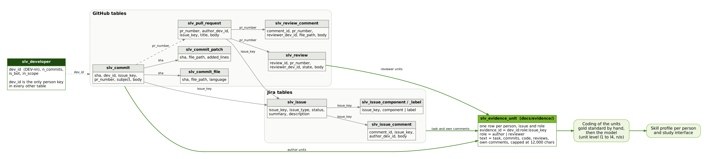

# Silver tables (pseudonymised export)

The tables of the silver layer, one CSV per table and project, so the path from raw records to
evidence units can be followed step by step. `nifi/` and `sakai/` hold the same tables.
Written by `pipeline/notebooks/slv/slv_06_export_tables.py` from
`pipeline/data/<project>/silver/silver.sqlite`. The evidence units themselves are in
[`../evidence/`](../evidence/README.md) and are not repeated here.

(`silver_data_model.svg` is the same picture as vector graphic, `silver_data_model.dot` its source.)

## How it fits together

1. **GitHub tables** (`slv_commit`, `slv_commit_file`, `slv_commit_patch`, `slv_pull_request`,
   `slv_review`, `slv_review_comment`) and **Jira tables** (`slv_issue`, `slv_issue_comment`,
   `slv_issue_component`, `slv_issue_label`) are linked by `issue_key` (commit or pull request to Jira
   issue), `pr_number` (commit to pull request, review to pull request) and `sha` (commit to files and patches).
2. `slv_developer` holds one row per person. `dev_id` (`DEV-nn`) is the only person key in all other tables.
3. An **evidence unit** gathers everything one person did in one issue, in one role:
   * `author`: the person's commits for the issue (messages, files touched, added code), plus the task text
     and the person's own Jira comments
   * `reviewer`: the person's review verdicts and line comments on the pull request for the issue
4. The units are what gets coded: first by hand (gold standard), then by the model, one level per unit and
   category (l1 to l4, or not observable). Taxonomy and coding rules: `docs/CODEBOOK.md`.

## Files per project

| File | Rows nifi | Rows sakai | Key |
|---|---|---|---|
| `slv_developer.csv` | 131 | 29 | `dev_id` |
| `slv_commit.csv` | 1,747 | 1,590 | `sha` |
| `slv_commit_file.csv` | 36,631 | 17,104 | `sha`, `file_path` |
| `slv_commit_patch.csv` | 33,835 | 8,585 | `sha`, `file_path` (added lines of the change) |
| `slv_issue.csv` | 2,356 | 2,195 | `issue_key` |
| `slv_issue_comment.csv` | 3,879 | 6,815 | `comment_id` |
| `slv_issue_component.csv` | 1,319 | 2,673 | `issue_key`, `component` |
| `slv_issue_label.csv` | 150 | 921 | `issue_key`, `label` |
| `slv_pull_request.csv` | 2,139 | 1,942 | `pr_number` |
| `slv_review.csv` | 4,713 | 5,911 | `review_id` |
| `slv_review_comment.csv` | 4,591 | 6,028 | `comment_id` |

Column names and types: `pipeline/sql/01_silver.sql`. Filtering never deletes rows; it sets flags
(`in_window`, `in_scope`, `is_bot`), so every row of the silver layer is in the files.

## What was removed

* Columns ending in `_hash` (salted hashes of accounts and logins). `dev_id` stays.
* E-mail addresses, `@handles`, Jira mentions, `Co-authored-by` style trailers, GitHub profile URLs.
* The names of the identified developers. Added code keeps its `@` (annotations such as `@Test`).

**Pseudonymised, not anonymous.** Names in free text that are not in the identity mapping can remain, and
commit, ticket and review texts are public and searchable. The identity mapping and the salt are not part
of this repository. Do not pass the files on.
